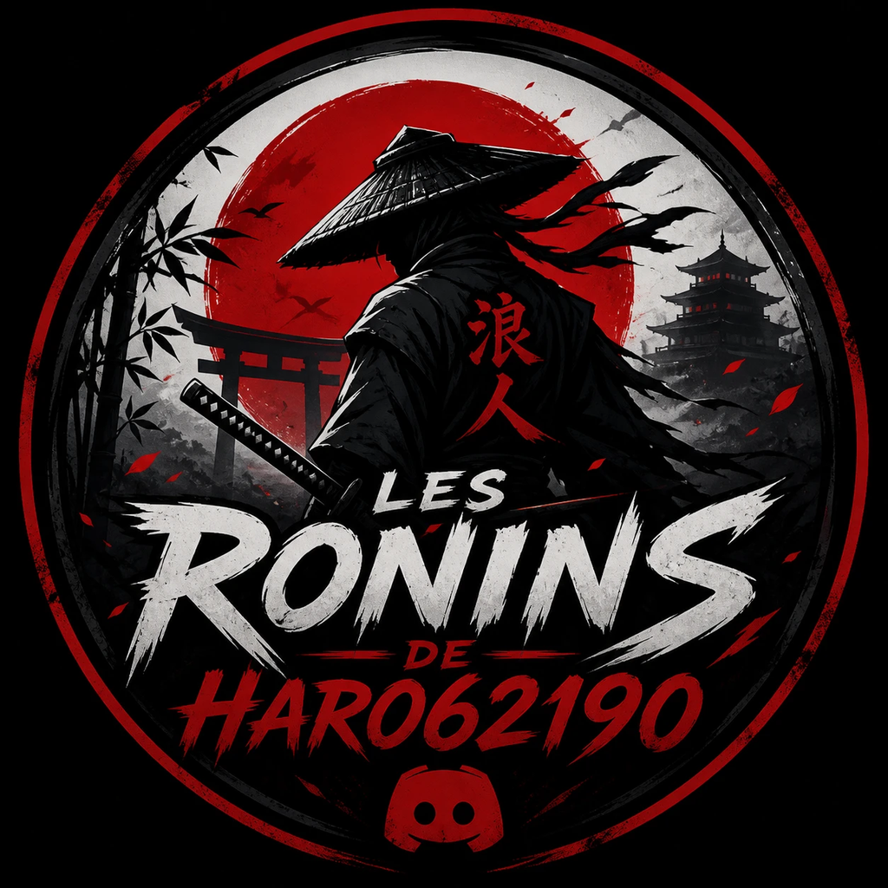

# 剣聖 Kensei — le bot des Ronins

<p align="center"></p>


**Kensei** (剣聖, « saint du sabre », le titre des plus grands maîtres samouraïs) est le bot Discord qui **construit automatiquement** le serveur **Les Ronins de haro62190** (rôles, catégories, salons, permissions, règlement) avec une seule commande **`/setup`**, puis **l'anime et le protège** : bienvenue / départ, tickets, niveaux et grades, alertes Twitch & TikTok, événements, musique, vocaux temporaires, anti-raid / anti-nuke, logs, sauvegardes et **tableau de bord web**.

Thème **samouraï cyberpunk** : noir, rouge néon et gris. Tout passe réellement par l'API Discord ; rien n'est jamais supprimé sans confirmation.

## 🗺️ Ce qui est créé

```
📊 統計 ・ STATS                (compteurs, visibles par tous)
   👥 Membres : 128   🟣 Twitch : 1 234   📱 TikTok : 5,6 k
⛩️ 入口 ・ ENTRÉE              (visible par tout le monde)
   🏮┃bienvenue                message d'accueil automatique
   ⛩️┃règlement                règlement + bouton « J'accepte » → débloque le serveur
   📡┃annonces  🔴┃en-live  📱┃tiktok  🎴┃rôles
🏯 道場 ・ LE DOJO             (membres ayant accepté le règlement)
   🍜┃discussion  📸┃médias  👾┃memes  🕹️┃gaming  🎧┃musique  🤖┃commandes
📡 配信 ・ STREAM
   🗓️┃planning  🎬┃clips  🖌️┃fan-art  💡┃suggestions
🩸 特別 ・ VIP & ABONNÉS        (VIP, abonnés Twitch, streamers, staff)
   🩸┃salon-vip   🩸 Lounge VIP
🎧 音 ・ VOCAUX
   ➕ Créer ton vocal  🌃 Shibuya  🎮 Akihabara #1 / #2  📺 Shinjuku ・ Watch party  💤 Ryokan ・ AFK
🎫 支援 ・ SUPPORT
   🎫┃ouvrir-un-ticket          + un salon privé par ticket
🛡️ 守 ・ STAFF                  (modérateurs uniquement)
   🛡️┃staff  🚨┃alertes-sécurité  📋┃logs  🔊┃logs-vocal
```

Kanji des catégories : 入口 = entrée, 道場 = dojo, 配信 = stream, 特別 = spécial, 音 = son, 支援 = assistance, 守 = protection ; les vocaux portent des noms de quartiers de Tokyo.

**Rôles (du plus haut au plus bas) :** 👑 Chef · 🛡️ Modérateur · 🤝 Amis (accès à tous les vocaux) · 🎥 Streamer (accès VIP) · 🩸 VIP · ⭐ Abonné Twitch · 🏯 Daimyō (niv. 30) · ⚔️ Samouraï (niv. 15) · 🗡️ Ashigaru (niv. 5) · ⚔️ Ronin (règlement accepté) · et en libre-service : 🔴 Notif Live · 📱 Notif TikTok · 📢 Notif Annonces · 🕹️ Joueur · 🎨 Artiste.

**Réglages de sécurité appliqués :** e-mail vérifié obligatoire, filtre de contenu explicite pour tous, notifications par défaut sur « @mentions uniquement » (évite que les gens quittent à cause du bruit).

Tout est modifiable dans [`config/server.js`](config/server.js).

---

## 🚀 Installation (≈ 10 minutes)

### 1. Créer le serveur Discord
Dans Discord : **＋ Ajouter un serveur → Créer le mien → Pour moi et mes amis**. Donne-lui un nom. (Pas besoin de créer de salons, le bot s'en charge.)

> 💡 Recommandé : **Paramètres du serveur → Activer la Communauté**. Ça permet le vrai salon d'annonces (que les autres serveurs peuvent suivre). Sinon, un salon texte classique est créé à la place.

### 2. Créer le bot
1. Va sur <https://discord.com/developers/applications> → **New Application**, nomme-la **Kensei**.
2. Onglet **Bot** → **Reset Token** → copie le token (garde-le secret !).
3. Toujours dans **Bot**, active les 2 *Privileged Gateway Intents* : **Server Members Intent** et **Message Content Intent**.
4. Onglet **OAuth2 → URL Generator** : coche `bot`, puis la permission **Administrator**. Ouvre l'URL générée et ajoute le bot à ton serveur.

### 3. (Optionnel) Alertes de live Twitch
1. Va sur <https://dev.twitch.tv/console/apps> → **Register Your Application**.
2. OAuth Redirect URL : `http://localhost` · Catégorie : *Chat Bot*.
3. Récupère le **Client ID**, puis **New Secret** pour le **Client Secret**.

### 4. Configurer et lancer
Il faut [Node.js](https://nodejs.org) **22.5 ou plus** (version LTS actuelle).

```bash
npm install
cp .env.example .env      # puis remplis le fichier .env
npm start                 # lance le bot (doit tourner en continu)
```

Puis dans Discord, tape **`/setup`** : le bot affiche ce qu'il va créer, tu confirmes, et il construit tout le serveur en direct (une sauvegarde est faite juste avant). Sans Discord ouvert, `npm run setup` fait la même chose depuis le terminal.

```bash
# équivalent terminal de /setup
npm run setup
```

Pour trouver le `GUILD_ID` : Discord → Paramètres utilisateur → Avancés → active le **Mode développeur**, puis clic droit sur ton serveur → **Copier l'identifiant du serveur**.

### 5. Finitions manuelles (2 minutes)
- **Paramètres du serveur → Rôles** : glisse le rôle du bot **tout en haut** (sinon il ne peut pas donner les rôles).
- Donne-toi le rôle **👑 Chef**, donne **🛡️ Modérateur** à tes modos et **🤝 Amis** à tes potes (ils pourront rejoindre tous les vocaux, y compris le vocal VIP).
- **Abonnés Twitch** : Paramètres utilisateur → Connexions → relie ton compte Twitch, puis dans *Paramètres du serveur → Intégrations → Twitch*, active la synchronisation des abonnés. Discord crée alors un rôle géré automatiquement : tu peux soit l'utiliser à la place de ⭐ Abonné Twitch, soit renommer ce rôle exactement `⭐ Abonné Twitch` dans la config.
- Remplis **🗓️┃planning** avec ton planning de streams.
- Crée un lien d'invitation permanent (clic droit sur 🏮┃bienvenue → Inviter → « Jamais » expirer) et mets-le dans ta bio / tes panneaux Twitch et une commande `!discord` dans ton chat.

---

## 🤖 Ce que fait le bot en continu (`npm start`)

| Fonction | Détail |
|---|---|
| Accueil | Message de bienvenue personnalisé dans 🏮┃bienvenue avec le numéro du membre |
| Bienvenue / départ | Messages personnalisables (`/welcome` ou tableau de bord) |
| Règlement | Le bouton « Je prête serment » donne le rôle ⚔️ Ronin, qui débloque le reste du serveur |
| Rôles libre-service | Boutons dans 🎴┃rôles (cliquer à nouveau retire le rôle) |
| Alerte live | Toutes les 60 s, vérifie Twitch ; au début du live, poste titre + jeu + miniature et mentionne 🔴 Notif Live. À la fin, l'annonce passe en « live terminé ». Pas de doublon si le bot redémarre pendant un live. |
| Logs | Arrivées, départs et messages supprimés dans 📋┃logs |

Le bot doit tourner en permanence : sur ton PC pendant les streams, ou mieux sur un petit hébergement (Raspberry Pi, VPS, Railway, fly.io…).

## ⌨️ Commandes `/` (façon MEE6)

Tape `/` dans Discord pour voir la liste. `/help` (ou `/aide`) affiche les commandes auxquelles tu as accès.

### 🏯 Administration (Kensei)

| Commande | Ce qu'elle fait |
|---|---|
| `/setup` | Construit **tout** le serveur : rôles + hiérarchie, catégories, salons, permissions, règlement, panneaux rôles/tickets, paramètres, icône, nom et avatar du bot |
| `/roles` | Crée / met à jour uniquement les rôles (couleurs, permissions, ordre) |
| `/channels` | Crée / met à jour uniquement les catégories, salons et permissions |
| `/welcome voir · bienvenue · depart · tester` | Messages de bienvenue et de départ |
| `/moderation voir · regler · protections · confiance` | Seuils anti-raid / anti-spam, invitations, anti-nuke, liste de confiance |
| `/config voir · niveaux · recompense · notifications · reinitialiser` | Niveaux, rôles de récompense, alertes Twitch / TikTok |
| `/backup creer · liste · exporter · supprimer` | Sauvegardes du serveur |
| `/restore id` ou `/restore fichier` | Restauration (recrée ce qui manque, ne supprime rien) |
| `/logo image:` | Change l'icône du serveur et/ou l'avatar du bot depuis Discord (`reinitialiser:True` = logo officiel) |
| `/embed` | Message intégré personnalisé (titre, couleur, image, mention…) |
| `/evenement` | Crée un **événement Discord** (date, durée, lieu) et l'annonce |
| `/ticket ajouter · retirer · fermer` | Gestion d'un ticket |

Chaque commande qui modifie le serveur affiche d'abord **ce qu'elle va faire** et attend ta **confirmation** (✅ / ❌). `/setup`, `/roles`, `/channels` et `/restore` font une sauvegarde automatique juste avant.

### 🎌 Communauté et modération

| Commande | Qui | Ce qu'elle fait |
|---|---|---|
| `/aide` `/ping` | tous | aide, test du bot |
| `/live` | tous | le stream est-il en ligne ? (titre, jeu, viewers) |
| `/profil [membre]` `/serveur` | tous | infos sur un membre / le serveur |
| `/sondage` | tous | sondage Discord (2 à 4 choix, durée en heures) |
| `/rang [membre]` `/classement` | tous | niveau, XP, top 10 |
| `/annonce` | staff | publie une annonce dans 📡┃annonces (option : mentionner 📢 Notif Annonces) |
| `/clear nombre [membre]` | staff | supprime jusqu'à 100 messages |
| `/warn` `/warns` `/clearwarns` | staff | avertissements (le membre reçoit un MP) |
| `/mute` `/unmute` | staff | rendre muet de 1 min à 1 semaine |
| `/kick` `/ban` | staff | expulser / bannir |

Toutes les actions de modération sont notées dans 📋┃logs. Les commandes staff sont cachées aux membres normaux (tu peux ajuster qui les voit dans *Paramètres du serveur → Intégrations → ton bot*).

**Niveaux :** chaque message rapporte 15 à 25 XP (une fois par minute max, anti-spam). Le bot félicite le membre à chaque niveau et donne automatiquement les **grades** : 🗡️ Ashigaru (niv. 5), ⚔️ Samouraï (niv. 15), 🏯 Daimyō (niv. 30) — d'autres récompenses avec `/config recompense` ou le tableau de bord.

## 📊 Salons compteurs

La catégorie **📊 統計 ・ STATS** (tout en haut) contient 3 salons vocaux visibles par tous, où personne ne peut entrer. Leur nom affiche :
- **👥 Membres** : membres du serveur Discord (sans les bots) ;
- **🟣 Twitch** : followers de `TWITCH_CHANNEL` (API Twitch officielle, mêmes identifiants que les alertes de live) ;
- **📱 TikTok** : abonnés de `TIKTOK_USERNAME` (lus sur la page publique du profil, TikTok n'ayant pas d'API).

Mise à jour **toutes les 10 minutes** (Discord limite le renommage d'un salon à 2 fois par 10 minutes). Commandes : `/stats voir`, `/stats rafraichir` et `/stats tiktok nombre:` pour donner une valeur de secours si TikTok bloque la lecture automatique. Les salons sont retrouvés par leur ID : tu peux les déplacer, le bot ne les recrée pas.

## 📺 Twitch : live, récap, clips, planning

- **Alerte de live** dans 🔴┃en-live (mention 🔴 Notif Live), et **récap automatique à la fin** : durée, pic de viewers, jeux joués, lien de la rediffusion.
- **Clips** : chaque nouveau clip de ta chaîne est posté dans 🎬┃clips (vérification toutes les 5 min).
- **Planning** : ton planning Twitch est affiché et tenu à jour dans 🗓️┃planning, et chaque stream des 7 prochains jours devient un **événement Discord** (supprimé s'il disparaît du planning Twitch). Remplis ton planning sur *Twitch → Tableau de bord créateur → Planning*.

Activables / désactivables avec `/config notifications` ou le tableau de bord.

## 💰 Économie « ryō » (両) et mini-jeux

| Gagner | Dépenser / jouer |
|---|---|
| 5-10 両 par message (1 fois par minute) | `/boutique` puis `/acheter` : couleurs de pseudo (🌸 Sakura, 🩸 Sang, ⚙️ Acier, 🌑 Ombre, 🏮 Lanterne), 🩸 VIP 7 jours |
| 2 両 par minute en vocal (à 2 minimum) | `/duel @membre mise:` — duel de samouraïs, le gagnant rafle la mise |
| `/daily` : 100 両 + bonus de série (jusqu'à 7 jours) | `/chifoumi choix: mise:` contre le bot |
| 500 両 le jour de ton anniversaire | `/donner @membre montant:` |

`/bourse` (solde), `/richesse` (top 10), `/ryo` (staff : ajouter / retirer). Les articles se règlent dans `config/server.js` → `shop`.

## 🎉 Animation

- **🎁 `/giveaway lancer prix: duree: gagnants:`** — bouton « Participer », tirage automatique (même après un redémarrage), `/giveaway relancer` pour un nouveau gagnant.
- **🎂 `/anniversaire definir jour: mois:`** — le jour J, message dans 🍜┃discussion, rôle 🎂 Anniversaire pendant 24 h et 500 両 offerts. `/anniversaire prochains`.
- **💡 Suggestions** — tout message posté dans 💡┃suggestions devient une carte avec votes 👍/👎, un fil de discussion et des boutons staff (acceptée / en cours / refusée, l'auteur est prévenu en MP).
- **🏯 Hall of Fame** — un message qui reçoit 5 réactions ⚔️ est mis à l'honneur dans 🏯┃hall-of-fame.
- **🎙️ XP en vocal** — 10 XP par minute passée en vocal à au moins 2 (pas en sourdine, pas en AFK).

## 🛡️ AutoMod Discord et vérification anti-bot

- **AutoMod natif** (créé par `/setup`, géré avec `/automod`) : mots interdits, arnaques et invitations, contenu choquant, spam de mentions (mute 10 min), spam. Appliqué par Discord lui-même, **même bot éteint**. Les modos ne sont pas concernés ; alertes dans 📋┃logs. `/automod ajouter-mot` / `retirer-mot`.
- **Vérification anti-bot** : après « Je prête serment », il faut cliquer sur le bon emoji (le katana, la lanterne…) pour obtenir ⚔️ Ronin. 3 erreurs = 5 min d'attente.

## 🏆 Saisons, carte de rang, commandes perso, menus de rôles, graphiques

- **`/rang`** affiche une **carte en image** (avatar, niveau, barre d'XP, grade, ryō, rang de la saison). Sur un VPS, installe les polices : `apt install -y fonts-dejavu fonts-noto-cjk`.
- **`/saison`** : classement de l'XP du mois. Le 1er : podium annoncé, 3000 / 2000 / 1000 両 pour le top 3 et rôle **🏆 Champion du mois** au premier.
- **Commandes personnalisées** (`!discord`, `!planning`…) : sur le site (*Commandes perso*) ou avec `/commande`.
- **Menus de rôles** : sur le site (*Menus de rôles*), choisis un salon et des rôles, le bot publie un message à boutons.
- **Graphiques** (site → *Graphiques*) : membres, followers Twitch, abonnés TikTok, messages, vocal, arrivées et départs sur 7, 30 ou 90 jours.

## 🎫 Tickets

Dans 🎫┃ouvrir-un-ticket, le bouton **Ouvrir un ticket** demande un sujet puis crée un salon privé visible seulement par le membre et les modos. Boutons **Prendre en charge** et **Fermer** (avec confirmation). À la fermeture, la transcription complète est envoyée dans 📋┃logs et en MP au membre. Un ticket ouvert à la fois par membre.

## 💾 Sauvegardes et base de données

Les données du bot (XP, avertissements, tickets, réglages, sauvegardes) sont dans une base **SQLite** : `data/ronin.db` (module SQLite intégré à Node.js, rien à installer). L'ancien fichier `data/db.json` est importé automatiquement.

- Sauvegarde **automatique chaque jour** (7 conservées) + `/backup creer` à la demande.
- Une sauvegarde contient : rôles (couleurs, permissions, ordre), catégories, salons, permissions de chaque salon, paramètres du serveur et réglages du bot. Les **messages** ne sont pas sauvegardés.
- `/restore` recrée les rôles et salons manquants, remet les permissions et les réglages. **Il ne supprime jamais rien.**
- `/backup exporter` donne un fichier `.json` à garder en lieu sûr (restaurable avec `/restore fichier`).
- Pour une copie complète de la base : copie `data/ronin.db` (bot arrêté) depuis le VPS avec `scp root@IP:/root/bot/data/ronin.db .`

## 🌐 Tableau de bord web

**Toutes les fonctionnalités sont pilotables depuis le site** (21 pages) :

| Serveur | Communauté | Stream | Sécurité |
|---|---|---|---|
| 🏯 Accueil (stats, top 10) | 🏮 Bienvenue & départ | 📡 Twitch & TikTok (live, clips, planning, sync) | 🛡️ Modération + verrouillage anti-raid |
| 🏗️ Construction : `/setup`, rôles, salons, AutoMod avec aperçu et progression en direct | ⚔️ Niveaux & grades | 📊 Compteurs (+ valeur TikTok de secours) | 🤖 AutoMod (mots interdits) |
| 🖼️ Logo & identité (icône, avatar, nom) | 💰 Économie & boutique (soldes, donner / retirer) | 📢 Annonce & embed | ⚠️ Avertissements |
| | 🎁 Giveaways (lancer, terminer, relancer) | 🎵 Musique (suivante, pause, boucle, stop) | 🎫 Tickets |
| | 🎌 Événements (créer, supprimer) | 🔊 Vocaux temporaires | 💾 Sauvegardes |
| | 🎂 Anniversaires · 💡 Suggestions (statuts) · 🏯 Hall of Fame, vérification, XP vocal | | |

**Sécurité :** connexion **avec Discord** ; seuls le propriétaire et les **Administrateurs** y accèdent (droits revérifiés à chaque page). Par défaut il n'écoute que sur la machine du bot (`127.0.0.1`) : il n'est **pas exposé sur Internet**.

**Activer :**
1. Portail développeur → ton appli → **OAuth2** → **Reset Secret** → copie-le dans `.env` : `DISCORD_CLIENT_SECRET=...`
2. Toujours dans **OAuth2 → Redirects**, ajoute : `http://localhost:3000/callback` et enregistre.
3. `pm2 restart bot-discord` → les logs affichent `🌐 Tableau de bord : http://localhost:3000`.

**Ouvrir depuis ton PC** (le bot est sur le VPS) — un tunnel SSH, gratuit et chiffré :
```bash
ssh -L 3000:localhost:3000 root@IP_DU_VPS
```
Laisse cette fenêtre ouverte et va sur <http://localhost:3000>. Si le bot tourne sur ton PC, ouvre directement <http://localhost:3000>.

> Pour l'ouvrir sans tunnel (depuis ton téléphone par exemple), il faut un nom de domaine et HTTPS : mets `DASHBOARD_HOST=127.0.0.1`, `DASHBOARD_URL=https://ton-domaine` et place devant un reverse proxy comme [Caddy](https://caddyserver.com) (certificat HTTPS gratuit). Ne l'expose jamais en HTTP simple.

## 🩺 Fiabilité

- **Tests automatiques** : `npm test` (et à chaque envoi sur GitHub, onglet *Actions* : ✅ ou ❌). Ils vérifient que toutes les commandes sont valides et que la logique (niveaux, saisons, dates, sauvegardes, économie…) fonctionne.
- **Retour arrière automatique** (VPS) : après une mise à jour, le bot doit redonner signe de vie en 2 minutes. Sinon `scripts/update.sh` revient tout seul à la version précédente, ignore la version fautive jusqu'à la suivante, et prévient le staff dans 🚨┃alertes-sécurité.
- **Copie de la base** : chaque nuit, `data/ronin.db` compressée est envoyée dans 💾┃sauvegardes (salon staff). Pour restaurer : décompresser (7-Zip) et remplacer `data/ronin.db`, bot arrêté. `/backup copie-base` pour en faire une tout de suite.
- **Santé** : `/statut` (temps de marche, latence, mémoire, version, sauvegardes), page *État du bot* du site, erreurs graves postées dans 🚨┃alertes-sécurité, et `/health` pour un service de surveillance gratuit (UptimeRobot) si le site est accessible depuis Internet.

## 🔒 Bot privé

Kensei ne sert que le serveur `GUILD_ID` : s'il est ajouté ailleurs, il **quitte ce serveur immédiatement** et prévient le staff dans 🚨┃alertes-sécurité. Il ne lit pas les messages privés et ses commandes `/` n'existent que sur ton serveur.

À régler aussi dans le portail développeur (sinon le bouton « Ajouter l'appli » reste visible) :
1. Onglet **Bot** → décoche **Public Bot** → *Save*. Seul toi peux alors l'inviter.
2. Onglet **Installation** → *Install Link* : **None**, et décoche **User Install** (garde seulement *Guild Install*).

## 🧪 Tester en local (VS Code)

```bash
npm run dev
```

Lance le bot et le **redémarre automatiquement** quand tu modifies un fichier de `src/`, `config/` ou `assets/`. Toutes les 2 minutes, il **récupère aussi les nouveautés de GitHub** (puis `npm install` / `npm run setup` si besoin, et redémarre). `Ctrl+C` pour arrêter.

⚠️ Un même bot ne doit pas tourner à deux endroits (il répondrait deux fois). Pour tester sans toucher au vrai serveur, crée un **bot de test** (nouvelle application dans le portail développeur, ex. « Kensei TEST ») et un **serveur Discord de test**, et mets leur token / ID dans le `.env` de ton PC. Sinon, arrête le bot du VPS pendant tes tests (`pm2 stop bot-discord`, puis `pm2 start bot-discord`).

## ☁️ Héberger 24h/24 sur un VPS, avec mises à jour automatiques

Sur un VPS Debian 12 / Ubuntu, en root :

```bash
apt update && apt install -y curl git
curl -fsSL https://deb.nodesource.com/setup_22.x | bash -
apt install -y nodejs
npm install -g pm2

git clone -b <branche> https://github.com/<toi>/<depot>.git /root/bot   # dépôt privé : voir « clé de déploiement » ci-dessous
cd /root/bot
nano .env                      # colle le contenu de ton .env
npm ci --omit=dev
npm run setup
pm2 start src/bot.js --name bot-discord
pm2 save && pm2 startup        # redémarrage automatique si le VPS redémarre

# Vérifie GitHub toutes les 5 minutes et met à jour le bot s'il y a du nouveau
(crontab -l 2>/dev/null; echo "*/5 * * * * /root/bot/scripts/update.sh >> /root/bot/update.log 2>&1") | crontab -
```

`scripts/update.sh` récupère les nouveautés, réinstalle les dépendances si besoin, relance `npm run setup` si la structure du serveur a changé, puis redémarre le bot. `.env` et `data/` ne sont jamais touchés. Historique des mises à jour : `cat /root/bot/update.log`.

**Dépôt privé — clé de déploiement (lecture seule) :** sur le VPS, `ssh-keygen -t ed25519 -N "" -f ~/.ssh/id_ed25519`, puis `cat ~/.ssh/id_ed25519.pub` et colle la clé dans GitHub → ton dépôt → *Settings → Deploy keys → Add deploy key* (ne coche pas *Allow write access*). Clone ensuite avec `git clone -b <branche> git@github.com:<toi>/<depot>.git /root/bot`.

## 📋 Logs

- **📋┃logs** : expulsions, bans, débans, mutes, ajouts/retraits de rôles, changements de pseudo, salons et rôles créés/supprimés/modifiés, bots et webhooks ajoutés, messages supprimés et modifiés, avertissements et actions des commandes `/`. Chaque entrée indique **qui** a fait l'action (journal d'audit Discord).
- **🔊┃logs-vocal** : arrivées, départs, changements de vocal, et qui a déconnecté / déplacé quelqu'un.

## 🛡️ Sécurité

| Protection | Déclencheur (modifiable dans `config/server.js` → `security`) | Réaction |
|---|---|---|
| **Anti-raid** | 8 arrivées en 20 s | Verrouillage 10 min : invitations en pause, nouveaux arrivants expulsés (avec un MP), vague d'arrivées expulsée |
| **Comptes récents** | `minAccountAgeDays` (désactivé par défaut) | Expulsion des comptes trop récents |
| **Anti-spam** | 6 messages en 5 s, 5 mentions, invitation Discord | Messages supprimés, mute 10 min |
| **Anti-nuke** | En 60 s : 3 salons ou 3 rôles supprimés, 4 bans, 5 kicks, 8 salons ou 3 webhooks créés | Tous les rôles de l'auteur retirés (ou bot expulsé), **salons et rôles supprimés recréés**, verrouillage, alerte au staff dans 🚨┃alertes-sécurité |
| **`/lockdown`** | Manuel (staff) | Verrouille / déverrouille le serveur |

Le staff (permission « Gérer les messages ») n'est pas concerné par l'anti-spam. Le propriétaire du serveur et les IDs listés dans `security.whitelist` (ou `SECURITY_WHITELIST` dans `.env`, séparés par des virgules) sont ignorés par l'anti-nuke.

⚠️ Le bot ne peut sanctionner que les rôles **en dessous du sien** : place le rôle du bot **tout en haut** de la liste. Les messages des salons supprimés ne peuvent pas être restaurés.

## 🎨 Images

`assets/icon.png` (logo officiel Les Ronins : icône du serveur appliquée par `/setup`, avatar du bot mis à jour automatiquement quand l'image change) et `assets/banner.png` (bannière, appliquée si le serveur a le niveau de boost 2 ; sinon utilisable pour Twitch, YouTube, X…).

## 📱 Alertes TikTok

Remplis `TIKTOK_USERNAME` dans `.env` (pseudo sans @) puis redémarre le bot. Il vérifie ton profil toutes les 2 minutes :
- **nouvelle vidéo** → lien posté dans 📱┃tiktok avec mention de 📱 Notif TikTok ;
- **live TikTok** → alerte dans 🔴┃en-live avec mention de 🔴 Notif Live, transformée en « live terminé » à la fin.

Au premier lancement, les vidéos déjà publiées sont mémorisées sans être annoncées. Nécessite yt-dlp (voir Musique). TikTok n'ayant pas d'API publique pour ça, le bot lit ta page publique : si TikTok change son site, il faut mettre yt-dlp à jour (`yt-dlp -U`, fait automatiquement chaque nuit).

## 🎵 Musique

`/play musique:<lien ou titre>` dans un vocal : YouTube, SoundCloud, Bandcamp… (tout ce que lit [yt-dlp](https://github.com/yt-dlp/yt-dlp)). Les playlists sont acceptées (50 morceaux max).
Autres commandes : `/skip` `/stop` `/pause` `/reprendre` `/boucle` `/melanger` `/file` `/retirer`. Le bot quitte le vocal quand la file est finie ou qu'il est seul.

**À installer une fois sur la machine du bot :**

```bash
# VPS Debian / Ubuntu
apt install -y ffmpeg unzip
curl -L https://github.com/yt-dlp/yt-dlp/releases/latest/download/yt-dlp_linux -o /usr/local/bin/yt-dlp && chmod +x /usr/local/bin/yt-dlp
curl -fsSL https://deno.land/install.sh | DENO_INSTALL=/usr/local sh -s -- -y   # requis par yt-dlp pour YouTube
(crontab -l; echo "0 4 * * * /usr/local/bin/yt-dlp -U >> /root/bot/update.log 2>&1") | crontab -   # yt-dlp à jour chaque nuit
pm2 restart bot-discord
```

Sur Windows : `winget install yt-dlp.yt-dlp Gyan.FFmpeg DenoLand.Deno` puis rouvre le terminal.

⚠️ YouTube interdit dans ses conditions d'utilisation la lecture de ses vidéos hors de son lecteur, et bloque souvent les adresses IP de VPS (« Sign in to confirm you're not a bot »). Si ça arrive : utilise SoundCloud, ou exporte les cookies YouTube d'un compte secondaire dans `cookies.txt` et indique son chemin dans `YTDLP_COOKIES`.

## 🔊 Vocaux temporaires

Rejoindre **➕ Créer ton vocal** crée un salon vocal perso et t'y déplace. Dans le chat du vocal, un panneau te demande s'il doit être **🔓 libre d'accès** ou **🔒 fermé**, avec aussi : ✏️ renommer, 👥 limite de places, ✅ autoriser quelqu'un (même fermé), 👢 expulser (il ne peut plus revenir), 👑 récupérer le salon si le propriétaire est parti.

Le créateur a tous les droits sur son salon (clic droit sur un membre → rendre muet, déplacer, déconnecter). Les 🛡️ modos ont les mêmes droits, et les 🤝 Amis peuvent entrer même quand c'est fermé. Si le propriétaire part, la couronne passe à quelqu'un d'autre ; quand le salon est vide, il est supprimé.

## ✏️ Personnaliser

Tout se passe dans [`config/server.js`](config/server.js) : noms et couleurs des rôles, salons, niveaux d'accès, règlement, message de bienvenue. Après une modification, relance `/setup` (ou `npm run setup`) : rien n'est recréé en double, les permissions et messages du bot sont simplement mis à jour.

Pour renommer un salon ou un rôle, change son `name` et ajoute l'ancien nom dans `formerNames` : `/setup` le renommera au lieu d'en créer un nouveau.

## 📂 Structure

```
config/server.js   structure du serveur (rôles, salons, règlement, messages…)
src/bot.js         point d'entrée : événements Discord, bienvenue/départ, XP, alertes Twitch
src/builder.js     construction du serveur via l'API Discord (/setup, /roles, /channels)
src/setup.js       /setup depuis le terminal (npm run setup)
src/admin.js       /setup /roles /channels /welcome /moderation /config /embed /evenement
src/backup.js      sauvegardes / restauration, /backup /restore
src/tickets.js     tickets d'assistance
src/stats.js       salons compteurs Discord / Twitch / TikTok, /stats
src/twitchlive.js  live + récap, clips, planning Twitch → événements Discord
src/economy.js     ryō, /daily, boutique, /duel, /chifoumi
src/giveaway.js    giveaways
src/birthdays.js   anniversaires
src/community.js   suggestions, Hall of Fame, vérification anti-bot
src/automod.js     règles AutoMod natives de Discord
src/voicexp.js     XP et ryō en vocal
src/temproles.js   rôles temporaires (VIP 7 jours, anniversaire)
src/health.js      santé : battement de cœur, /statut, alertes d'erreurs
src/seasons.js     saisons mensuelles
src/rankcard.js    carte de rang en image
src/custom.js      commandes personnalisées et menus de rôles
src/history.js     historique quotidien · src/charts.js graphiques SVG
tests/             tests automatiques (npm test) · .github/workflows/ci.yml
docs/carte-du-code/  carte interactive du code générée avec Graphify (graphe.html, architecture.html, RAPPORT.md)
src/dashboard.js   tableau de bord web (serveur, connexion, pages principales)
src/dashboard-pages.js  pages : construction, logo, économie, giveaways, événements, anniversaires, suggestions, compteurs, musique, vocaux, AutoMod…
src/settings.js    réglages modifiables à chaud
src/store.js       base SQLite (data/ronin.db)
src/confirm.js     confirmations ✅ / ❌ et progression
src/commands.js    commandes communautaires et modération
src/security.js    anti-raid, anti-spam, anti-nuke, /lockdown
src/logs.js        logs (journal d'audit, vocal, messages modifiés)
src/levels.js      niveaux et grades
src/music.js       musique (yt-dlp + ffmpeg)
src/tempvoice.js   vocaux temporaires
src/tiktok.js      alertes TikTok · src/twitch.js client Twitch · src/ytdlp.js appels yt-dlp
src/shared.js      messages et utilitaires communs
assets/            icône et bannière (浪人 · Les Ronins)
scripts/update.sh  mise à jour automatique depuis GitHub (VPS)
scripts/dev.js     mode test local : redémarrage auto + mises à jour GitHub (npm run dev)
```

**Pourquoi JavaScript et pas TypeScript ?** Le bot tourne sans étape de compilation : `git pull` + redémarrage suffisent, ce qui rend la mise à jour automatique du VPS fiable. Le code est découpé en modules documentés ; une migration TypeScript reste possible plus tard.
