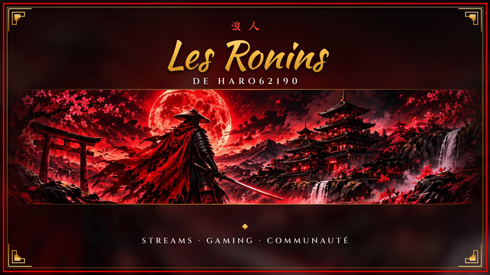

# 剣聖 Kensei — le bot des Ronins

<p align="center"></p>



**Kensei** (剣聖, « saint du sabre », le titre des plus grands maîtres samouraïs) est le bot Discord qui **construit automatiquement** le serveur **Les Ronins de haro62190** (rôles, catégories, salons, permissions, règlement) avec une seule commande **`/setup`**, puis **l'anime et le protège** : bienvenue / départ, tickets, niveaux et grades, alertes Twitch & TikTok, événements, musique, vocaux temporaires, anti-raid / anti-nuke, logs, sauvegardes et **tableau de bord web**.

Thème **samouraï cyberpunk** : noir, rouge néon et gris. Tout passe réellement par l'API Discord ; rien n'est jamais supprimé sans confirmation.

## 🗺️ Ce qui est créé

```
📊 統計 ・ STATS                (compteurs, visibles par tous)
   👥 Membres : 128   🟣 Twitch : 1 234   📱 TikTok : 5,6 k
⛩️ 入口 ・ ENTRÉE              (visible par tout le monde)
   🏮┃bienvenue                message d'accueil automatique
   ⛩️┃règlement                règlement + bouton « J'accepte » → débloque le serveur
   📡┃annonces  🔴┃en-live  📱┃tiktok  🎴┃rôles
🏯 道場 ・ LE DOJO             (membres ayant accepté le règlement)
   🍜┃discussion  📸┃médias  👾┃memes  🕹️┃gaming  🎧┃musique  🤖┃commandes
📡 配信 ・ STREAM
   🗓️┃planning  🎬┃clips  🖌️┃fan-art  💡┃suggestions
🩸 特別 ・ VIP & ABONNÉS        (VIP, abonnés Twitch, streamers, staff)
   🩸┃salon-vip   🩸 Lounge VIP
🎧 音 ・ VOCAUX
   ➕ Créer ton vocal  🌃 Shibuya  🎮 Akihabara #1 / #2  📺 Shinjuku ・ Watch party  💤 Ryokan ・ AFK
🎫 支援 ・ SUPPORT
   🎫┃ouvrir-un-ticket          + un salon privé par ticket
🛡️ 守 ・ STAFF                  (modérateurs uniquement)
   🛡️┃staff  🚨┃alertes-sécurité  📋┃logs  🔊┃logs-vocal
```

Kanji des catégories : 入口 = entrée, 道場 = dojo, 配信 = stream, 特別 = spécial, 音 = son, 支援 = assistance, 守 = protection ; les vocaux portent des noms de quartiers de Tokyo.

**Rôles (du plus haut au plus bas) :** 👑 Chef · 🏯 Gardien · 🛡️ Modérateur · 🔰 Sentinelle · 🤝 Amis (accès à tous les vocaux) · 🎥 Streamer (accès VIP) · 🩸 VIP · ⭐ Abonné Twitch · 🏯 Daimyō (niv. 30) · ⚔️ Samouraï (niv. 15) · 🗡️ Ashigaru (niv. 5) · ⚔️ Ronin (règlement accepté) · et en libre-service : 🔴 Notif Live · 📱 Notif TikTok · 📢 Notif Annonces · 🕹️ Joueur · 🎨 Artiste.

**Réglages de sécurité appliqués :** e-mail vérifié obligatoire, filtre de contenu explicite pour tous, notifications par défaut sur « @mentions uniquement » (évite que les gens quittent à cause du bruit).

Tout est modifiable dans [`config/server.js`](config/server.js).

---

## 🚀 Installation (≈ 10 minutes)

### 1. Créer le serveur Discord
Dans Discord : **＋ Ajouter un serveur → Créer le mien → Pour moi et mes amis**. Donne-lui un nom. (Pas besoin de créer de salons, le bot s'en charge.)

> 💡 Recommandé : **Paramètres du serveur → Activer la Communauté**. Ça permet le vrai salon d'annonces (que les autres serveurs peuvent suivre). Sinon, un salon texte classique est créé à la place.

### 2. Créer le bot
1. Va sur <https://discord.com/developers/applications> → **New Application**, nomme-la **Kensei**.
2. Onglet **Bot** → **Reset Token** → copie le token (garde-le secret !).
3. Toujours dans **Bot**, active les 2 *Privileged Gateway Intents* : **Server Members Intent** et **Message Content Intent**.
4. Dans le dossier du bot, après `npm install` et le `.env` rempli : **`npm run invite`**. Ouvre le lien affiché pour ajouter le bot **avec les permissions minimales** (pas besoin d'Administrateur). Puis place le rôle du bot tout en haut de la liste des rôles.

### 3. (Optionnel) Alertes de live Twitch
1. Va sur <https://dev.twitch.tv/console/apps> → **Register Your Application**.
2. OAuth Redirect URL : `http://localhost` · Catégorie : *Chat Bot*.
3. Récupère le **Client ID**, puis **New Secret** pour le **Client Secret**.

### 4. Configurer et lancer
Il faut [Node.js](https://nodejs.org) **22.5 ou plus** (version LTS actuelle).

```bash
npm install
cp .env.example .env      # puis remplis le fichier .env
npm start                 # lance le bot (doit tourner en continu)
```

Puis dans Discord, tape **`/setup`** : le bot affiche ce qu'il va créer, tu confirmes, et il construit tout le serveur en direct (une sauvegarde est faite juste avant). Sans Discord ouvert, `npm run setup` fait la même chose depuis le terminal.

```bash
# équivalent terminal de /setup
npm run setup
```

Pour trouver le `GUILD_ID` : Discord → Paramètres utilisateur → Avancés → active le **Mode développeur**, puis clic droit sur ton serveur → **Copier l'identifiant du serveur**.

### 5. Finitions manuelles (2 minutes)
- **Paramètres du serveur → Rôles** : glisse le rôle du bot **tout en haut** (sinon il ne peut pas donner les rôles).
- Donne-toi le rôle **👑 Chef**, donne **🛡️ Modérateur** à tes modos et **🤝 Amis** à tes potes (ils pourront rejoindre tous les vocaux, y compris le vocal VIP).
- **Abonnés Twitch** : Paramètres utilisateur → Connexions → relie ton compte Twitch, puis dans *Paramètres du serveur → Intégrations → Twitch*, active la synchronisation des abonnés. Discord crée alors un rôle géré automatiquement : tu peux soit l'utiliser à la place de ⭐ Abonné Twitch, soit renommer ce rôle exactement `⭐ Abonné Twitch` dans la config.
- Remplis **🗓️┃planning** avec ton planning de streams.
- Crée un lien d'invitation permanent (clic droit sur 🏮┃bienvenue → Inviter → « Jamais » expirer) et mets-le dans ta bio / tes panneaux Twitch et une commande `!discord` dans ton chat.

---

## 🤖 Ce que fait le bot en continu (`npm start`)

| Fonction | Détail |
|---|---|
| Accueil | Message de bienvenue personnalisé dans 🏮┃bienvenue avec le numéro du membre |
| Bienvenue / départ | Messages personnalisables (`/welcome` ou tableau de bord) |
| Règlement | Le bouton « Je prête serment » donne le rôle ⚔️ Ronin, qui débloque le reste du serveur |
| Rôles libre-service | Boutons dans 🎴┃rôles (cliquer à nouveau retire le rôle) |
| Alerte live | Toutes les 60 s, vérifie Twitch ; au début du live, poste titre + jeu + miniature et mentionne 🔴 Notif Live. À la fin, l'annonce passe en « live terminé ». Pas de doublon si le bot redémarre pendant un live. |
| Logs | Arrivées, départs et messages supprimés dans 📋┃logs |
| Quêtes, saisons, pilier, membre du mois | Remise à zéro et récompenses automatiques (minuit, lundi, 1er du mois) |
| Lives Twitch / TikTok | Annonce mise à jour pendant le live, moments forts du chat, récap et historique à la fin, top clips le lundi |
| Soirées, événements | Rappels en MP 1 h / 30 min avant, liste d'attente automatique |
| Défis collectifs | Barre de progression mise à jour, ryō distribués quand l'objectif est atteint |
| Récap hebdo | Chaque lundi : récap pour les membres + rapport pour le staff (salons inutilisés, idées d'événements) |
| Guide | 📖┃guide et 📘┃guide-staff remis à jour à chaque démarrage du bot |
| Sauvegardes | Copies de la base vérifiées (7 jours, 4 semaines, 6 mois) et réparation automatique si elle est abîmée |

Le bot doit tourner en permanence : sur ton PC pendant les streams, ou mieux sur un petit hébergement (Raspberry Pi, VPS, Railway, fly.io…).

## ⌨️ Commandes `/` (façon MEE6)

Tape `/` dans Discord pour voir la liste. `/help` (ou `/aide`) affiche les commandes auxquelles tu as accès.

### 🏯 Administration (Kensei)

| Commande | Ce qu'elle fait |
|---|---|
| `/setup` | Construit **tout** le serveur : rôles + hiérarchie, catégories, salons, permissions, règlement, panneaux rôles/tickets, paramètres, icône, nom et avatar du bot |
| `/roles` | Crée / met à jour uniquement les rôles (couleurs, permissions, ordre) |
| `/channels` | Crée / met à jour uniquement les catégories, salons et permissions |
| `/welcome voir · bienvenue · depart · tester` | Messages de bienvenue et de départ |
| `/moderation voir · regler · protections · confiance` | Seuils anti-raid / anti-spam, invitations, anti-nuke, liste de confiance |
| `/config voir · niveaux · recompense · notifications · reinitialiser` | Niveaux, rôles de récompense, alertes Twitch / TikTok |
| `/backup creer · liste · exporter · supprimer` | Sauvegardes du serveur |
| `/restore id` ou `/restore fichier` | Restauration (recrée ce qui manque, ne supprime rien) |
| `/logo image:` | Change l'icône du serveur et/ou l'avatar du bot depuis Discord (`reinitialiser:True` = logo officiel) |
| `/embed` | Message intégré personnalisé (titre, couleur, image, mention…) |
| `/evenement` | Crée un **événement Discord** (date, durée, lieu) et l'annonce |
| `/ticket ajouter · retirer · fermer` | Gestion d'un ticket |

Chaque commande qui modifie le serveur affiche d'abord **ce qu'elle va faire** et attend ta **confirmation** (✅ / ❌). `/setup`, `/roles`, `/channels` et `/restore` font une sauvegarde automatique juste avant.

### 🎌 Communauté et modération

| Commande | Qui | Ce qu'elle fait |
|---|---|---|
| `/aide` `/ping` | tous | aide, test du bot |
| `/live` | tous | le stream est-il en ligne ? (titre, jeu, viewers) |
| `/profil [membre]` `/serveur` | tous | infos sur un membre / le serveur |
| `/sondage` | tous | sondage Discord (2 à 4 choix, durée en heures) |
| `/rang [membre]` `/classement` | tous | niveau, XP, top 10 |
| `/annonce` | staff | publie une annonce dans 📡┃annonces (option : mentionner 📢 Notif Annonces) |
| `/clear nombre [membre]` | staff | supprime jusqu'à 100 messages |
| `/warn` `/warns` `/clearwarns` | staff | avertissements (le membre reçoit un MP) |
| `/mute` `/unmute` | staff | rendre muet de 1 min à 1 semaine |
| `/kick` `/ban` | staff | expulser / bannir |

Toutes les actions de modération sont notées dans 📋┃logs. Les commandes staff sont cachées aux membres normaux (tu peux ajuster qui les voit dans *Paramètres du serveur → Intégrations → ton bot*).

**Niveaux :** chaque message rapporte 15 à 25 XP (une fois par minute max, anti-spam). Le bot félicite le membre à chaque niveau et donne automatiquement les **grades** : 🗡️ Ashigaru (niv. 5), ⚔️ Samouraï (niv. 15), 🏯 Daimyō (niv. 30) — d'autres récompenses avec `/config recompense` ou le tableau de bord.

## 📊 Salons compteurs

La catégorie **📊 統計 ・ STATS** (tout en haut) contient 3 salons vocaux visibles par tous, où personne ne peut entrer. Leur nom affiche :
- **👥 Membres** : membres du serveur Discord (sans les bots) ;
- **🟣 Twitch** : followers de `TWITCH_CHANNEL` (API Twitch officielle, mêmes identifiants que les alertes de live) ;
- **📱 TikTok** : abonnés de `TIKTOK_USERNAME` (lus sur la page publique du profil, TikTok n'ayant pas d'API).

Mise à jour **toutes les 10 minutes** (Discord limite le renommage d'un salon à 2 fois par 10 minutes). Commandes : `/stats voir`, `/stats rafraichir` et `/stats tiktok nombre:` pour donner une valeur de secours si TikTok bloque la lecture automatique. Les salons sont retrouvés par leur ID : tu peux les déplacer, le bot ne les recrée pas.

## 📺 Twitch : live, récap, clips, planning

- **Alerte de live** dans 🔴┃en-live (mention 🔴 Notif Live) avec un bouton **▶️ Regarder le live**. L'annonce est **mise à jour pendant le live** (viewers, pic, durée, changement de jeu).
- **Récap automatique à la fin** : durée, pic et moyenne de viewers, **followers gagnés**, jeux joués, membres les plus actifs sur le Discord pendant le live, bouton « Revoir le live ».
- **Historique des lives** : `/streams` (7 jours, 30 jours, 90 jours ou 1 an) et la page *📺 Lives & statistiques* du site (graphique des viewers par live, tableau complet).
- **🎉 Paliers d'abonnés** : annonce dans 📡┃annonces quand les followers Twitch, les abonnés TikTok ou les membres Discord passent 50, 100, 250, 500, 1000…
- **Clips** : chaque nouveau clip de ta chaîne est posté dans 🎬┃clips (vérification toutes les 5 min).
- **Planning** : ton planning Twitch est affiché et tenu à jour dans 🗓️┃planning, et chaque stream des 7 prochains jours devient un **événement Discord** (supprimé s'il disparaît du planning Twitch). Remplis ton planning sur *Twitch → Tableau de bord créateur → Planning*.

Activables / désactivables avec `/config notifications` ou le tableau de bord.

## 💰 Économie « ryō » (両) et mini-jeux

| Gagner | Dépenser / jouer |
|---|---|
| 5-10 両 par message (1 fois par minute) | `/boutique` puis `/acheter` : couleurs de pseudo (🌸 Sakura, 🩸 Sang, ⚙️ Acier, 🌑 Ombre, 🏮 Lanterne), 🩸 VIP 7 jours |
| 2 両 par minute en vocal (à 2 minimum) | `/duel @membre mise:` — duel de samouraïs, le gagnant rafle la mise |
| `/daily` : 100 両 + bonus de série (jusqu'à 7 jours) | `/chifoumi choix: mise:` contre le bot |
| 500 両 le jour de ton anniversaire | `/donner @membre montant:` |

`/bourse` (solde), `/richesse` (top 10), `/ryo` (staff : ajouter / retirer). Les articles se règlent dans `config/server.js` → `shop`.

## 📜 Quêtes, boosts, grades et classements

- **`/quetes`** : chaque membre a **3 quêtes du jour** et **3 quêtes de la semaine** (écrire, vocal, réactions, /daily, duels, suggestions, giveaways…), récompensées en ryō. Nouvelles quêtes à minuit et le lundi.
- **`/boost lancer heures: xp: ryo:`** (staff) : événement **XP ×2** ou **ryō ×3** pendant quelques heures, annoncé dans 📡┃annonces. Aussi sur le site (*Quêtes, boosts & grades*).
- **Niveaux plus justes** : pas d'XP pour les messages trop courts (« ok », « mdr ») ni dans 🤖┃commandes ; **bonus ×1,25** pour 🩸 VIP, ⭐ Abonné Twitch et les boosters Nitro.
- **Récompenses de grade** : prime de **500 / 1500 / 5000 両** en devenant 🗡️ Ashigaru / ⚔️ Samouraï / 🏯 Daimyō, et un bonus sur chaque `/daily` selon ton grade.
- **🔥 Pilier de la semaine** : chaque lundi, le membre qui a gagné le plus d'XP reçoit le rôle et 750 両.
- **`/top categorie:`** : XP, semaine, mois, messages, vocal, ryō, quêtes, duels, actifs pendant les lives. **`/profil`** montre toutes les statistiques d'un membre (aussi sur le site → *Membres & classements*).

Tout se règle sur le site, page *📜 Quêtes, boosts & grades*.

## 🎮 Gaming

- **Profil joueur** : `/joueur profil` (plateformes PC / PlayStation / Xbox / Switch / mobile, disponibilités, jeux, pseudos PSN / Xbox / Steam / Activision), `/joueur voir`, `/joueurs jeu:` pour trouver des partenaires.
- **Recherche de coéquipiers** : `/recherche jeu: places:` publie une annonce dans 🎮┃recherche-joueurs avec un bouton « Je viens » et propose les membres qui ont ce jeu dans leur profil.
- **Équipes automatiques** : `/equipes taille:` répartit les joueurs de ton vocal en équipes équilibrées (selon l'Elo du jeu), avec un bouton pour créer un vocal par équipe et y déplacer tout le monde.
- **Tournois** (🏆┃tournois) : `/tournoi-admin creer` (solo ou équipes, places, date, prix en ryō), inscription par bouton ou `/tournoi equipe`, tableau à élimination directe avec têtes de série, résultats avec `/tournoi-admin resultat` ou sur le site.
- **Classements compétitifs** : un classement Elo par jeu (`/classement-jeu`), alimenté par les tournois et `/match`.
- **Soirées gaming** (🌙┃soirées-gaming) : `/soiree` avec réservation de places, liste d'attente automatique, rappel en MP 1 h avant, événement Discord créé tout seul.
- **Calendrier** : `/calendrier` regroupe soirées, tournois, lives, événements, défis et anniversaires. Les membres « intéressés » par un événement Discord reçoivent un rappel en MP 30 min avant.

## 🔴 Pendant les lives

- **🎲┃jeux-du-live** : `/quiz` (bonnes réponses récompensées en ryō, bonus aux 3 plus rapides, banque de questions avec `/quiz hasard`), `/prono` (les membres misent leurs ryō, le pot est partagé entre les gagnants), `/vote` (résultats en direct).
- **Moments forts** : pendant le live, le bot lit le chat Twitch (lecture seule, sans compte) et repère les pics d'activité. Le staff est prévenu pour clipper, et le récap de fin de live contient un lien vers chaque moment dans la rediffusion.
- **Clips** : galerie sur le site, `/clips`, et top 5 de la semaine posté chaque lundi dans 🎬┃clips.

## 👥 Communauté

- **🌟 Membre du mois** : score sur plusieurs critères (XP, vocal, remerciements reçus, quêtes, suggestions, présence en live). Le 1er du mois : rôle 🌟 Membre du mois + 2000 両. `/membre-du-mois` pour le classement provisoire.
- **🙏 Réputation** : `/merci @membre` (3 par jour), `/rep`.
- **🤝 Parrainage** : `/parrainage lien` donne un lien d'invitation perso ; quand le filleul atteint le niveau 3, le parrain gagne 500 両 et le filleul 250 両.
- **🎯 Défis collectifs** : `/defi` (staff) fixe un objectif commun (messages, vocal, quêtes, nouveaux membres…), barre de progression dans 📡┃annonces, ryō pour chaque participant si l'objectif est atteint. `/defis` pour les voir.
- **📝 Candidatures** : `/candidature` modérateur ou streamer partenaire → formulaire → décision du staff senior par boutons dans 📝┃candidatures (rôle donné automatiquement, réponse en MP).

## 🤖 Automatisation

- **Récap hebdomadaire** chaque lundi dans 📡┃annonces, et **rapport staff** : salons inutilisés depuis 30 jours, meilleurs créneaux d'activité, jeux les plus joués, idées d'événements.
- **Signalements suivis** : `/signaler @membre raison:` → carte dans 🚩┃signalements avec boutons pour le staff, MP de suivi, `/mes-signalements`.

## 🖥️ Nouveautés du tableau de bord

🔔 Centre d'alertes (signalements, candidatures, tickets, quarantaines, permissions, erreurs, avec une cloche dans l'en-tête) · ✉️ Éditeur de messages avec aperçu en direct (et modification d'un message du bot) · 🏆 Tournois (tableau, résultats en un clic, classements Elo) · 🌙 Soirées, défis & calendrier · 👥 Équipes & inscriptions · 📊 Stats Twitch + Discord réunies · 🎬 Galerie de clips · historique de chaque membre sur la page *Membres*.

## 🎉 Animation

- **🎁 `/giveaway lancer prix: duree: gagnants:`** — bouton « Participer », tirage automatique (même après un redémarrage), `/giveaway relancer` pour un nouveau gagnant.
- **🎂 `/anniversaire definir jour: mois:`** — le jour J, message dans 🍜┃discussion, rôle 🎂 Anniversaire pendant 24 h et 500 両 offerts. `/anniversaire prochains`.
- **💡 Suggestions** — tout message posté dans 💡┃suggestions devient une carte avec votes 👍/👎, un fil de discussion et des boutons staff (acceptée / en cours / refusée, l'auteur est prévenu en MP).
- **🏯 Hall of Fame** — un message qui reçoit 5 réactions ⚔️ est mis à l'honneur dans 🏯┃hall-of-fame.
- **🎙️ XP en vocal** — 10 XP par minute passée en vocal à au moins 2 (pas en sourdine, pas en AFK).

## 🛡️ AutoMod Discord et vérification anti-bot

- **AutoMod natif** (créé par `/setup`, géré avec `/automod`) : mots interdits, arnaques et invitations, contenu choquant, spam de mentions (mute 10 min), spam. Appliqué par Discord lui-même, **même bot éteint**. Les modos ne sont pas concernés ; alertes dans 📋┃logs. `/automod ajouter-mot` / `retirer-mot`.
- **Vérification anti-bot** : après « Je prête serment », il faut cliquer sur le bon emoji (le katana, la lanterne…) pour obtenir ⚔️ Ronin. 3 erreurs = 5 min d'attente.

## 🏆 Saisons, carte de rang, commandes perso, menus de rôles, graphiques

- **Passage de niveau** : le bot poste une **bannière en image** (samouraï, lune rouge, cadre rouge et or) avec « Félicitations *pseudo* ! », le nouveau niveau et une plaque « Nouveau grade » (désactivable sur le site → *Niveaux & grades*).
- **Identité visuelle** : carte de rang, bannière et tableau de bord suivent la maquette officielle Kensei. Les décors sont dans `assets/` (`levelup-bg.jpg`, `rankcard-bg.jpg`, `logo-kensei.jpg`, `dashboard-*.jpg`) et les polices dans `assets/fonts/` (libres, licence OFL) : remplace un fichier par une image de même format pour changer le décor.
- **`/rang`** affiche une **carte en image** (avatar, niveau, barre d'XP, grade, ryō, rang de la saison). Sur un VPS, installe les polices : `apt install -y fonts-dejavu fonts-noto-cjk`.
- **`/saison`** : classement de l'XP du mois. Le 1er : podium annoncé, 3000 / 2000 / 1000 両 pour le top 3 et rôle **🏆 Champion du mois** au premier.
- **Commandes personnalisées** (`!discord`, `!planning`…) : sur le site (*Commandes perso*) ou avec `/commande`.
- **Menus de rôles** : sur le site (*Menus de rôles*), choisis un salon et des rôles, le bot publie un message à boutons.
- **Graphiques** (site → *Graphiques*) : membres, followers Twitch, abonnés TikTok, messages, vocal, arrivées et départs sur 7, 30 ou 90 jours.

## 🛟 Serveur de secours (piratage, suppression, corruption)

Si le serveur est piraté ou détruit, le bot recopie tout **à l'identique** sur un serveur de secours :
rôles (couleurs, permissions, ordre), catégories, salons et permissions, nom, icône, bannière, émojis, messages du bot (règlement, rôles, guide, tickets), **les 50 derniers messages de chaque salon** (auteur, avatar, date), et il **rend ses rôles à chaque membre** quand il rejoint (sauf les rôles Administrateur, à redonner à la main). Niveaux, ryō, quêtes, tickets… sont liés aux comptes : rien n'est perdu.

**Préparation (une fois)** : crée un serveur Discord vide, colle son identifiant sur le site (*🛟 Serveur de secours*) ou dans `.env` (`SECOURS_GUILD_ID=`), invite le bot dessus avec le lien « serveur de secours » de `npm run invite` (Administrateur : sans lui Discord l’empêche de recréer les rôles qui ont des permissions qu’il n’a pas) et mets son rôle tout en haut. Le bot y reste, avec seulement la commande `/secours`.

**Chaque jour**, une copie est prise et gardée sur le VPS. Elle n'est **jamais écrasée** par un serveur qui vient d'être vidé (plus de 30 % de salons ou de rôles disparus).

**En cas de problème** : sur le serveur de secours, `/secours restaurer` (ou le bouton du site), puis `/secours prevenir` pour envoyer le lien aux membres en MP. Pour en faire le nouveau serveur principal : change `GUILD_ID` dans `.env` et redémarre. Seul le propriétaire du serveur peut restaurer.

## 🎫 Tickets

Dans 🎫┃ouvrir-un-ticket, le bouton **Ouvrir un ticket** demande un sujet puis crée un salon privé visible seulement par le membre et les modos. Boutons **Prendre en charge** et **Fermer** (avec confirmation). À la fermeture, la transcription complète est envoyée dans 📋┃logs et en MP au membre. Un ticket ouvert à la fois par membre.

## 💾 Sauvegardes et base de données

Les données du bot (XP, avertissements, tickets, réglages, sauvegardes) sont dans une base **SQLite** : `data/ronin.db` (module SQLite intégré à Node.js, rien à installer). L'ancien fichier `data/db.json` est importé automatiquement.

- Sauvegarde **automatique chaque jour** (7 conservées) + `/backup creer` à la demande.
- Une sauvegarde contient : rôles (couleurs, permissions, ordre), catégories, salons, permissions de chaque salon, paramètres du serveur et réglages du bot. Les **messages** ne sont pas sauvegardés.
- `/restore` recrée les rôles et salons manquants, remet les permissions et les réglages. **Il ne supprime jamais rien.**
- `/backup exporter` donne un fichier `.json` à garder en lieu sûr (restaurable avec `/restore fichier`).
- Pour une copie complète de la base : copie `data/ronin.db` (bot arrêté) depuis le VPS avec `scp root@IP:/root/bot/data/ronin.db .`

## 🌐 Tableau de bord web

**Nouveautés** : interface modernisée (interrupteurs, cartes, menu fixe), **accueil en temps réel** (membres, vocal, messages du jour, live, tickets, quarantaine, latence — mis à jour toutes les 5 s), **🧩 Modules** (activer / couper chaque fonctionnalité), **🎭 Rôles & permissions** (permissions de chaque rôle + donner / retirer un rôle à un membre), **📜 Journal d'admin** (toutes les commandes du staff et actions du site), **🎫 Tickets** (fermeture depuis le site avec transcription), **📡 Twitch & TikTok** (comptes réglables sans toucher au `.env`, bouton de test), **🗄️ Copies de la base** (créer, tester, restaurer), **🩺 Diagnostic** (permissions, hiérarchie, salons manquants, configuration, outils, intégrité, dernières erreurs).

**Toutes les fonctionnalités sont pilotables depuis le site** (21 pages) :

| Serveur | Communauté | Stream | Sécurité |
|---|---|---|---|
| 🏯 Accueil (stats, top 10) | 🏮 Bienvenue & départ | 📡 Twitch & TikTok (live, clips, planning, sync) | 🛡️ Modération + verrouillage anti-raid |
| 🏗️ Construction : `/setup`, rôles, salons, AutoMod avec aperçu et progression en direct | ⚔️ Niveaux & grades | 📊 Compteurs (+ valeur TikTok de secours) | 🤖 AutoMod (mots interdits) |
| 🖼️ Logo & identité (icône, avatar, nom) | 💰 Économie & boutique (soldes, donner / retirer) | 📢 Annonce & embed | ⚠️ Avertissements |
| | 🎁 Giveaways (lancer, terminer, relancer) | 🎵 Musique (suivante, pause, boucle, stop) | 🎫 Tickets |
| | 🎌 Événements (créer, supprimer) | 🔊 Vocaux temporaires | 💾 Sauvegardes |
| | 🎂 Anniversaires · 💡 Suggestions (statuts) · 🏯 Hall of Fame, vérification, XP vocal | | |

**Sécurité :** connexion **avec Discord** ; seuls le propriétaire et les **Administrateurs** y accèdent (droits revérifiés à chaque page). Par défaut il n'écoute que sur la machine du bot (`127.0.0.1`) : il n'est **pas exposé sur Internet**.

**Activer :**
1. Portail développeur → ton appli → **OAuth2** → **Reset Secret** → copie-le dans `.env` : `DISCORD_CLIENT_SECRET=...`
2. Toujours dans **OAuth2 → Redirects**, ajoute : `http://localhost:3000/callback` et enregistre.
3. `pm2 restart bot-discord` → les logs affichent `🌐 Tableau de bord : http://localhost:3000`.

**Ouvrir depuis ton PC** (le bot est sur le VPS) — un tunnel SSH, gratuit et chiffré :
```bash
ssh -L 3000:localhost:3000 root@IP_DU_VPS
```
Laisse cette fenêtre ouverte et va sur <http://localhost:3000>. Si le bot tourne sur ton PC, ouvre directement <http://localhost:3000>.

> Pour l'ouvrir sans tunnel (depuis ton téléphone par exemple), il faut un nom de domaine et HTTPS : mets `DASHBOARD_HOST=127.0.0.1`, `DASHBOARD_URL=https://ton-domaine` et place devant un reverse proxy comme [Caddy](https://caddyserver.com) (certificat HTTPS gratuit). Ne l'expose jamais en HTTP simple.

## 🎖️ Grades du staff

| Grade | Peut | Ne peut pas |
|---|---|---|
| 🏯 **Gardien** | bannir, expulser, mute, avertir, `/lockdown`, événements, salon 💾┃sauvegardes | (tout le reste est réservé à 👑 Chef / admins) |
| 🛡️ **Modérateur** | expulser, mute sans limite, avertir / effacer les avertissements, `/annonce`, `/embed`, pseudos | bannir, `/lockdown` |
| 🔰 **Sentinelle** | supprimer des messages (`/clear`), avertir, mute **1 h max**, déplacer en vocal | expulser, bannir, effacer les avertissements |

Chaque grade ne peut sanctionner que les grades en dessous du sien. Tous voient les salons staff, les tickets et ne sont pas concernés par l'AutoMod. Les permissions se règlent dans `config/server.js` (champ `permissions` de chaque rôle).

## 📖 Guide des commandes

- **📖┃guide** (visible par tous) : comment débuter, XP, ryō, saisons, tout ce qu'on peut faire sans commande, et la liste des commandes des membres.
- **📘┃guide-staff** : réflexes du staff et commandes de modération / administration.
- **`/guide`** (et `/guide staff:True`) : le guide en message privé.
- **[docs/GUIDE.md](docs/GUIDE.md)** : version écrite.

Les listes sont **générées à partir des commandes du bot** : `/setup` remet le guide à jour, et `npm run guide` régénère `docs/GUIDE.md`.

## 🩺 Fiabilité

- **Tests automatiques** : `npm test` (et à chaque envoi sur GitHub, onglet *Actions* : ✅ ou ❌). Ils vérifient que toutes les commandes sont valides et que la logique (niveaux, saisons, dates, sauvegardes, économie…) fonctionne.
- **Retour arrière automatique** (VPS) : après une mise à jour, le bot doit redonner signe de vie en 2 minutes. Sinon `scripts/update.sh` revient tout seul à la version précédente, ignore la version fautive jusqu'à la suivante, et prévient le staff dans 🚨┃alertes-sécurité.
- **Copies locales de la base** (`data/sauvegardes/`) : une par jour, en générations (7 jours · 4 semaines · 6 mois · 5 manuelles). **Chaque copie est testée** juste après sa création (ouverte à part, contrôle d'intégrité, relecture des données). Si la base est abîmée au démarrage, le bot **repart tout seul de la dernière copie vérifiée** (l'ancienne est gardée de côté) et prévient le staff. Restauration manuelle depuis le tableau de bord (appliquée au redémarrage).
- **Aucune perte au redémarrage** : les données sont enregistrées à l'arrêt, même en cas de plantage (testé automatiquement).
- **Journal des erreurs** : `data/logs/erreurs.log` (secrets masqués, rotation automatique).
- **Copie de la base** : chaque nuit, `data/ronin.db` compressée est envoyée dans 💾┃sauvegardes (salon staff). Pour restaurer : décompresser (7-Zip) et remplacer `data/ronin.db`, bot arrêté. `/backup copie-base` pour en faire une tout de suite.
- **Santé** : `/statut` (temps de marche, latence, mémoire, version, sauvegardes), page *État du bot* du site, erreurs graves postées dans 🚨┃alertes-sécurité, et `/health` pour un service de surveillance gratuit (UptimeRobot) si le site est accessible depuis Internet.

## 🔒 Bot privé

Kensei ne sert que le serveur `GUILD_ID` : s'il est ajouté ailleurs, il **quitte ce serveur immédiatement** et prévient le staff dans 🚨┃alertes-sécurité. Il ne lit pas les messages privés et ses commandes `/` n'existent que sur ton serveur.

À régler aussi dans le portail développeur (sinon le bouton « Ajouter l'appli » reste visible) :
1. Onglet **Bot** → décoche **Public Bot** → *Save*. Seul toi peux alors l'inviter.
2. Onglet **Installation** → *Install Link* : **None**, et décoche **User Install** (garde seulement *Guild Install*).

## 🧪 Tester en local (VS Code)

```bash
npm run dev
```

Lance le bot et le **redémarre automatiquement** quand tu modifies un fichier de `src/`, `config/` ou `assets/`. Toutes les 2 minutes, il **récupère aussi les nouveautés de GitHub** (puis `npm install` / `npm run setup` si besoin, et redémarre). `Ctrl+C` pour arrêter.

⚠️ Un même bot ne doit pas tourner à deux endroits (il répondrait deux fois). Pour tester sans toucher au vrai serveur, crée un **bot de test** (nouvelle application dans le portail développeur, ex. « Kensei TEST ») et un **serveur Discord de test**, et mets leur token / ID dans le `.env` de ton PC. Sinon, arrête le bot du VPS pendant tes tests (`pm2 stop bot-discord`, puis `pm2 start bot-discord`).

## ☁️ Héberger 24h/24 sur un VPS, avec mises à jour automatiques

Sur un VPS Debian 12 / Ubuntu, en root :

```bash
apt update && apt install -y curl git
curl -fsSL https://deb.nodesource.com/setup_22.x | bash -
apt install -y nodejs
npm install -g pm2

git clone -b <branche> https://github.com/<toi>/<depot>.git /root/bot   # dépôt privé : voir « clé de déploiement » ci-dessous
cd /root/bot
nano .env                      # colle le contenu de ton .env
npm ci --omit=dev
npm run setup
pm2 start src/bot.js --name bot-discord
pm2 save && pm2 startup        # redémarrage automatique si le VPS redémarre

# Vérifie GitHub toutes les 5 minutes et met à jour le bot s'il y a du nouveau
(crontab -l 2>/dev/null; echo "*/5 * * * * /root/bot/scripts/update.sh >> /root/bot/update.log 2>&1") | crontab -
```

`scripts/update.sh` récupère les nouveautés, réinstalle les dépendances si besoin, relance `npm run setup` si la structure du serveur a changé, puis redémarre le bot. `.env` et `data/` ne sont jamais touchés. Historique des mises à jour : `cat /root/bot/update.log`.

**Dépôt privé — clé de déploiement (lecture seule) :** sur le VPS, `ssh-keygen -t ed25519 -N "" -f ~/.ssh/id_ed25519`, puis `cat ~/.ssh/id_ed25519.pub` et colle la clé dans GitHub → ton dépôt → *Settings → Deploy keys → Add deploy key* (ne coche pas *Allow write access*). Clone ensuite avec `git clone -b <branche> git@github.com:<toi>/<depot>.git /root/bot`.

## 🌐 Page vitrine et 📈 surveillance (sur le VPS)

**DNS d'abord** (Hostinger → Domaines → haro62190.tech → Zone DNS) : enregistrements **A** `@`, `www` et `status` vers l'IP du VPS (remplace l'ancien A de `@`).

| Script (en root sur le VPS) | Ce qu'il fait |
| --- | --- |
| `bash /root/bot/scripts/site-install.sh` | Publie la vitrine sur `https://haro62190.tech` (+ www), garde le tableau de bord sur `bot.`, prépare `status.` ; HTTPS automatique (Caddy) |
| `bash /root/bot/scripts/uptime-kuma-install.sh` | Uptime Kuma sur `https://status.haro62190.tech` (crée ton compte admin tout de suite) |

- **Vitrine** : présentation, live Twitch intégré pendant les lives, prochains lives, meilleurs clips, compteurs, bouton « Rejoindre le Discord » (invitation créée par le bot). Textes et liens : tableau de bord → *🌐 Page vitrine*.
- **Surveillance** (dans Uptime Kuma) : sonde HTTP `http://127.0.0.1:3000/health` (bot), HTTP `https://haro62190.tech` (site) ; notification **Discord** avec un webhook d'un salon staff (Paramètres du salon → Intégrations → Webhooks).

## 📋 Logs

- **📋┃logs** : expulsions, bans, débans, mutes, ajouts/retraits de rôles, changements de pseudo, salons et rôles créés/supprimés/modifiés, bots et webhooks ajoutés, messages supprimés et modifiés, avertissements et actions des commandes `/`. Chaque entrée indique **qui** a fait l'action (journal d'audit Discord).
- **🔊┃logs-vocal** : arrivées, départs, changements de vocal, et qui a déconnecté / déplacé quelqu'un.

## 🛡️ Sécurité

**Permissions minimales** : le bot n'a plus besoin d'Administrateur. `npm run invite` donne le lien avec exactement les permissions nécessaires (et pourquoi). Au démarrage, il signale dans 🚨┃alertes-sécurité les permissions manquantes. Il ne donne jamais à un rôle une permission qu'il n'a pas lui-même, et ne retire jamais celles qu'il ne contrôle pas (comme l'Administrateur de 👑 Chef) : à donner à la main, `/setup` te le rappelle.

**⛓️ Quarantaine** (`/quarantaine @membre [durée] [raison]`, `/liberer`) : le membre perd ses rôles (mémorisés) et ne voit plus que 🏚️┃cachot où le staff lui parle ; tout lui est rendu à la sortie. Utilisée aussi par l'anti-raid et l'anti-nuke **à la place des expulsions** : en cas de fausse alerte, rien n'est perdu.

- **Anti-raid** : vague d'arrivées *ou* plusieurs comptes suspects (moins de 7 jours ou sans photo) d'un coup → verrouillage ; seuls les comptes suspects sans rôle sont mis en quarantaine 24 h (les comptes anciens ne sont jamais visés). `raidAction: 'kick'` pour expulser à la place.
- **Anti-spam** : 1re infraction = avertissement, ensuite mute de plus en plus long ; messages répétés détectés ; les invitations vers **ton** serveur restent autorisées.
- **Anti-nuke** : en plus des suppressions / bans de masse, un **rôle dangereux donné** ou des **droits d'administration ajoutés à un rôle** par quelqu'un hors liste de confiance sont **annulés aussitôt** ; un bot ajouté par un membre non autorisé est expulsé.
- **Liste de confiance** : `/moderation confiance`, page Modération du site, ou `SECURITY_WHITELIST` dans `.env`.
- **Commandes** : chaque commande du staff exige sa permission Discord, revérifiée par le bot à chaque utilisation ; toutes sont notées dans le journal d'administration.
- **Tableau de bord** : limite de tentatives par IP, déconnexion après 2 h d'inactivité, cookie `__Host-` et HSTS en HTTPS, journal des connexions et actions. Derrière Caddy : `DASHBOARD_TRUST_PROXY=1`.
- **Secrets** : tokens et clés masqués dans les journaux et alertes ; `.env` remis en lecture seule pour son propriétaire (chmod 600) s'il était trop ouvert. Journal des erreurs : `data/logs/erreurs.log`.
- **Mentions** : par défaut le bot ne peut **jamais** mentionner @everyone, @here ou un rôle ; seuls les messages prévus pour (alertes de live, annonces) notifient leur rôle.
- **Données saisies** : aucune clé spéciale (`__proto__`, `constructor`…) n'est lue depuis un bouton, une commande ou le site ; les liens sont limités au `https` ; les mots du chat Twitch montrés au staff sont nettoyés (pas de liens ni de mentions).
- **Anti-triche économie** : récompenses plafonnées (quiz 500 両, défi 2 000 両, tournoi 20 000 両), l'organisateur d'un quiz ou d'un pronostic n'y participe pas, pronostic jamais clôturé = remboursé après 24 h, parrainage refusé pour les comptes de moins de 14 jours et les anciens membres (10 récompenses max par mois), `/merci` après 3 jours sur le serveur, `/recherche` limitée à une toutes les 5 min, `/equipes` ne déplace que les joueurs du vocal concerné.
- **Site** : connexion liée au navigateur qui l'a commencée, jetons comparés à temps constant, IP réelle prise derrière le proxy sans pouvoir être falsifiée, connexions lentes coupées, aucune erreur technique affichée au visiteur.

### Réglages détaillés

| Protection | Déclencheur (modifiable dans `config/server.js` → `security`) | Réaction |
|---|---|---|
| **Anti-raid** | 8 arrivées en 20 s | Verrouillage 10 min : invitations en pause, nouveaux arrivants expulsés (avec un MP), vague d'arrivées expulsée |
| **Comptes récents** | `minAccountAgeDays` (désactivé par défaut) | Expulsion des comptes trop récents |
| **Anti-spam** | 6 messages en 5 s, 5 mentions, invitation Discord | Messages supprimés, mute 10 min |
| **Anti-nuke** | En 60 s : 3 salons ou 3 rôles supprimés, 4 bans, 5 kicks, 8 salons ou 3 webhooks créés | Tous les rôles de l'auteur retirés (ou bot expulsé), **salons et rôles supprimés recréés**, verrouillage, alerte au staff dans 🚨┃alertes-sécurité |
| **`/lockdown`** | Manuel (staff) | Verrouille / déverrouille le serveur |

Le staff (permission « Gérer les messages ») n'est pas concerné par l'anti-spam. Le propriétaire du serveur et les IDs listés dans `security.whitelist` (ou `SECURITY_WHITELIST` dans `.env`, séparés par des virgules) sont ignorés par l'anti-nuke.

⚠️ Le bot ne peut sanctionner que les rôles **en dessous du sien** : place le rôle du bot **tout en haut** de la liste. Les messages des salons supprimés ne peuvent pas être restaurés.

## 🎨 Images

`assets/icon.png` (logo officiel Les Ronins : icône du serveur appliquée par `/setup`, avatar du bot mis à jour automatiquement quand l'image change) et `assets/banner.png` (bannière, appliquée si le serveur a le niveau de boost 2 ; sinon utilisable pour Twitch, YouTube, X…).

## ▶️ Alertes YouTube

Mets ta chaîne sur le tableau de bord (*📡 Twitch, TikTok & YouTube* : `@pseudo`, lien de la chaîne ou ID `UC…`) ou `YOUTUBE_CHANNEL` dans `.env`. Toutes les 10 minutes, le bot lit le flux public de la chaîne (gratuit, sans clé) : chaque **nouvelle vidéo ou Short** est postée dans ▶️┃youtube avec mention de ▶️ Notif YouTube. Les vidéos déjà en ligne ne sont pas annoncées.

Le salon compteur **▶️ YouTube : …** (catégorie 📊 STATS, créé par `/setup`) affiche le nombre d'abonnés, mis à jour toutes les 10 minutes. YouTube n'affiche publiquement qu'un nombre arrondi (ex. 1,23 k) ; valeur de secours possible avec `/stats youtube` ou sur *📊 Compteurs*.

## 😀 Émojis personnalisés

Tableau de bord → *😀 Émojis* (choisis l'image, le nom se remplit tout seul) ou `/emoji ajouter image: [nom:]`, `/emoji supprimer`, `/emoji liste`. PNG, JPEG, WebP ou **GIF animé**, 256 Ko max. Le bot a besoin de la permission *Gérer les expressions* : ouvre une fois le nouveau lien de `npm run invite`.

## 🏮 Bannière de bienvenue

Chaque arrivée est accueillie par une bannière en image (décor Kensei, avatar, pseudo, « Ronin n°… ») sous le message de bienvenue. Désactivable sur *🏮 Bienvenue & départ*.

## 🛡️ Kensei Guardian

Toutes les 5 minutes, le gardien contrôle : connexion Discord, permissions et position du rôle du bot, salons/rôles manquants, Twitch, TikTok (et yt-dlp), YouTube, compteurs, copies de la base, serveur de secours, mémoire, disque, et les **erreurs répétées** (la même 5 fois en une heure). Quand un problème apparaît, il prévient le staff dans 🚨┃alertes-sécurité avec une **correction proposée**, puis quand c'est résolu (rappel toutes les 12 h si ça dure). **Il ne modifie jamais rien lui-même.** `/guardian` ou la page *🛡️ Kensei Guardian* du site pour un contrôle immédiat ; alertes désactivables dans *🧩 Modules*.

## 🔧 Fiabilité et administration

- **Mises à jour sûres** : `scripts/update.sh` lance la vérification et les tests **avant** de configurer le serveur ou de redémarrer. En cas d'échec, la nouvelle version n'est pas installée (le bot continue sur l'ancienne) et le gardien prévient le staff. Si le bot ne redémarre pas, retour arrière automatique (comme avant). `SKIP_TESTS=1` pour forcer.
- **Exercice de restauration** chaque nuit : la nouvelle copie de la base est rechargée par le vrai code du bot dans un dossier temporaire (la vraie base n'est jamais touchée).
- **Kensei Guardian** contrôle aussi : la configuration `.env`, les commandes qui échouent souvent, les tâches automatiques bloquées, la maintenance oubliée. Chaque problème devient un **incident** (page *📜 Incidents* : ouvert → vu par un admin → résolu, avec sa durée).
- **❤️ Santé générale** : une page qui résume tout (verdict, problèmes et corrections, sauvegardes).
- **🕓 Historique des réglages** : chaque réglage modifié, par qui, d'où (site, Discord, automatique), avant → après (valeurs sensibles masquées).
- **🛠️ Mode maintenance** : couper temporairement certaines fonctions (et réserver les commandes au staff), avec fin automatique ; les réglages ne sont pas touchés et les protections restent actives.
- **🔍 Comparer deux sauvegardes** (page *💾 Sauvegardes*) : rôles, salons, paramètres du serveur et réglages qui ont changé.

## 🔔 Notifications sans excès

- `/notifications` : chaque membre choisit les annonces qui le mentionnent (rôles 🔴 Live, ▶️ YouTube…), les MP du bot qu'il accepte (rappels, suggestions, recherche de joueurs, parrainage, signalements), des **heures calmes** (les MP qui peuvent attendre partent ensuite, les rappels horaires sont abandonnés) et un **maximum de MP par jour** (6 par défaut). Les messages de modération sont toujours envoyés.
- **🕸️ Salons inactifs** (site, et menu dans le rapport staff du lundi) : archiver (lecture seule, rangé dans 🗄️ ARCHIVES, **réversible** avec « Remettre »), garder (plus signalé pendant 60 j) ou relancer (message d'animation). Rien n'est fait sans un admin.
- **🎬 Idées de contenu** : à la fin de chaque live, le staff reçoit les meilleurs moments à monter en Short / TikTok (clips les plus vus, pics du chat, liens horodatés vers la rediffusion).

## 📊 Sondages, 🧭 accueil personnalisé

- `/sondage question: choix: Warzone ; Fortnite ; Minecraft [duree:2h] [anonyme:] [multiple:] [resultats_en_direct:]` : 2 à 10 choix, **anonyme par défaut**, date limite, résultats publiés automatiquement à la fin (bouton 🔒 pour clore plus tôt : auteur ou staff).
- Après le règlement, bouton **🧭 Personnaliser mon arrivée** (ou `/accueil`) : le membre choisit ses intérêts et ses jeux et reçoit un guide avec seulement ce qui le concerne, plus les rôles adaptés. Liste des jeux : page *🏮 Bienvenue & départ*.
- Lives : le récap de fin de live montre les **clips du live** et la **comparaison avec les 4 lives précédents** ; `/streams semaines:true` (et la page *📺 Lives*) compare les 8 dernières semaines.

## 📱 Alertes TikTok

Remplis `TIKTOK_USERNAME` dans `.env` (pseudo sans @) puis redémarre le bot. Il vérifie ton profil toutes les 2 minutes :
- **nouvelle vidéo** → lien posté dans 📱┃tiktok avec mention de 📱 Notif TikTok ;
- **live TikTok** → alerte dans 🔴┃en-live avec mention de 🔴 Notif Live et bouton « Regarder », transformée à la fin en récap (durée, pic de viewers si TikTok le donne) et enregistrée dans l'historique `/streams`.

Au premier lancement, les vidéos déjà publiées sont mémorisées sans être annoncées. Nécessite yt-dlp (voir Musique). TikTok n'ayant pas d'API publique pour ça, le bot lit ta page publique : si TikTok change son site, il faut mettre yt-dlp à jour (`yt-dlp -U`, fait automatiquement chaque nuit).

## 🎵 Musique

`/play musique:<lien ou titre>` dans un vocal : YouTube, SoundCloud, Bandcamp… (tout ce que lit [yt-dlp](https://github.com/yt-dlp/yt-dlp)). Les playlists sont acceptées (50 morceaux max).
Autres commandes : `/skip` `/stop` `/pause` `/reprendre` `/boucle` `/melanger` `/file` `/retirer`. Le bot quitte le vocal quand la file est finie ou qu'il est seul.

**À installer une fois sur la machine du bot :**

```bash
# VPS Debian / Ubuntu
apt install -y ffmpeg unzip
curl -L https://github.com/yt-dlp/yt-dlp/releases/latest/download/yt-dlp_linux -o /usr/local/bin/yt-dlp && chmod +x /usr/local/bin/yt-dlp
curl -fsSL https://deno.land/install.sh | DENO_INSTALL=/usr/local sh -s -- -y   # requis par yt-dlp pour YouTube
(crontab -l; echo "0 4 * * * /usr/local/bin/yt-dlp -U >> /root/bot/update.log 2>&1") | crontab -   # yt-dlp à jour chaque nuit
pm2 restart bot-discord
```

Sur Windows : `winget install yt-dlp.yt-dlp Gyan.FFmpeg DenoLand.Deno` puis rouvre le terminal.

⚠️ YouTube interdit dans ses conditions d'utilisation la lecture de ses vidéos hors de son lecteur, et bloque souvent les adresses IP de VPS (« Sign in to confirm you're not a bot »). Si ça arrive : utilise SoundCloud, ou exporte les cookies YouTube d'un compte secondaire dans `cookies.txt` et indique son chemin dans `YTDLP_COOKIES`.

## 🔊 Vocaux temporaires

Rejoindre **➕ Créer ton vocal** crée un salon vocal perso et t'y déplace. Dans le chat du vocal, un panneau te demande s'il doit être **🔓 libre d'accès** ou **🔒 fermé**, avec aussi : ✏️ renommer, 👥 limite de places, ✅ autoriser quelqu'un (même fermé), 👢 expulser (il ne peut plus revenir), 👑 récupérer le salon si le propriétaire est parti.

Le créateur a tous les droits sur son salon (clic droit sur un membre → rendre muet, déplacer, déconnecter). Les 🛡️ modos ont les mêmes droits, et les 🤝 Amis peuvent entrer même quand c'est fermé. Si le propriétaire part, la couronne passe à quelqu'un d'autre ; quand le salon est vide, il est supprimé.

## ✏️ Personnaliser

Tout se passe dans [`config/server.js`](config/server.js) : noms et couleurs des rôles, salons, niveaux d'accès, règlement, message de bienvenue. Après une modification, relance `/setup` (ou `npm run setup`) : rien n'est recréé en double, les permissions et messages du bot sont simplement mis à jour.

Pour renommer un salon ou un rôle, change son `name` et ajoute l'ancien nom dans `formerNames` : `/setup` le renommera au lieu d'en créer un nouveau.

## 📂 Structure

```
config/server.js   structure du serveur (rôles, salons, règlement, messages…)
src/bot.js         point d'entrée : événements Discord, bienvenue/départ, XP, alertes Twitch
src/builder.js     construction du serveur via l'API Discord (/setup, /roles, /channels)
src/setup.js       /setup depuis le terminal (npm run setup)
src/admin.js       /setup /roles /channels /welcome /moderation /config /embed /evenement
src/backup.js      sauvegardes / restauration, /backup /restore
src/tickets.js     tickets d'assistance
src/stats.js       salons compteurs Discord / Twitch / TikTok, /stats
src/twitchlive.js  live + récap, clips, planning Twitch → événements Discord
src/economy.js     ryō, /daily, boutique, /duel, /chifoumi
src/giveaway.js    giveaways
src/birthdays.js   anniversaires
src/community.js   suggestions, Hall of Fame, vérification anti-bot
src/automod.js     règles AutoMod natives de Discord
src/voicexp.js     XP et ryō en vocal
src/temproles.js   rôles temporaires (VIP 7 jours, anniversaire)
src/health.js      santé : battement de cœur, /statut, alertes d'erreurs
src/seasons.js     saisons mensuelles
src/rankcard.js    carte de rang en image
src/custom.js      commandes personnalisées et menus de rôles
src/guide.js       guide des commandes (salons 📖 / 📘, /guide, docs/GUIDE.md)
src/history.js     historique quotidien · src/charts.js graphiques SVG
tests/             tests automatiques (npm test) · .github/workflows/ci.yml
docs/carte-du-code/  carte interactive du code générée avec Graphify (graphe.html, architecture.html, RAPPORT.md)
src/dashboard.js   tableau de bord web (serveur, connexion, pages principales)
src/dashboard-pages.js  pages : construction, logo, économie, giveaways, événements, anniversaires, suggestions, compteurs, musique, vocaux, AutoMod…
src/settings.js    réglages modifiables à chaud
src/store.js       base SQLite (data/ronin.db)
src/confirm.js     confirmations ✅ / ❌ et progression
src/commands.js    commandes communautaires et modération
src/security.js    anti-raid, anti-spam, anti-nuke, /lockdown
src/logs.js        logs (journal d'audit, vocal, messages modifiés)
src/levels.js      niveaux et grades
src/music.js       musique (yt-dlp + ffmpeg)
src/tempvoice.js   vocaux temporaires
src/tiktok.js      alertes TikTok · src/twitch.js client Twitch · src/ytdlp.js appels yt-dlp
src/shared.js      messages et utilitaires communs
src/quests.js      quêtes du jour et de la semaine · src/boost.js événements XP / ryō ×2
src/memberstats.js statistiques par membre, /top · src/feed.js fil des événements et historique des membres
src/levelcard.js   bannière « Passage de niveau » · src/brand.js couleurs et polices Kensei (assets/fonts)
src/streams.js     historique des lives, paliers d'abonnés, /streams, /clips · src/twitchchat.js moments forts
src/gaming.js      profils joueurs, /recherche, /equipes, classements Elo
src/tournaments.js tournois · src/nights.js soirées gaming, réservations, /calendrier, rappels
src/livegames.js   quiz, pronostics, votes pendant les lives
src/social.js      membre du mois, réputation (/merci), parrainage · src/challenges.js défis collectifs
src/applications.js candidatures · src/reports.js signalements suivis · src/insights.js récap hebdo et rapport staff
src/quarantine.js  quarantaine · src/permissions.js permissions minimales · src/audit.js journal d'admin
src/rescue.js      serveur de secours (copie complète, restauration, rôles rendus)
src/dbbackup.js    copies de la base · src/logger.js journal d'erreurs · src/redact.js masquage des secrets
src/dashboard-admin.js · dashboard-community.js · dashboard-ops.js   autres pages du tableau de bord
assets/            icône, bannière, décors Kensei (carte de rang, bannière de niveau, site) et polices libres
scripts/update.sh  mise à jour automatique depuis GitHub (VPS)
scripts/banner.js  régénère la bannière du serveur (npm run banner)
scripts/dev.js     mode test local : redémarrage auto + mises à jour GitHub (npm run dev)
```

**Pourquoi JavaScript et pas TypeScript ?** Le bot tourne sans étape de compilation : `git pull` + redémarrage suffisent, ce qui rend la mise à jour automatique du VPS fiable. Le code est découpé en modules documentés ; une migration TypeScript reste possible plus tard.
